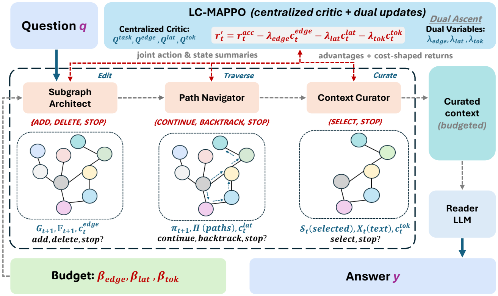

<div align="center">

<picture>
  <source media="(prefers-color-scheme: dark)" srcset="assets/logo-dark.svg">
  
</picture>

<p><strong>Budget-aware multi-agent context engineering over knowledge graphs</strong></p>

<p>
  <a href="https://arxiv.org/abs/2509.21035"></a>
  <a href="https://arxiv.org/abs/2509.21035"></a>
  <a href="LICENSE"></a>
  
  
</p>

<p>Yang Zhao<sup>*</sup>, Chengxiao Dai<sup>*</sup>, Wei Zhuo, Yue Xiu, Dusit Niyato<br>
<sub><sup>*</sup>Equal contribution</sub></p>

<p><strong>English</strong> | <a href="README.zh-CN.md">简体中文</a></p>

</div>

## Overview

Official implementation of *CLAUSE: Agentic Neuro-Symbolic Knowledge Graph Reasoning via Dynamic Learnable Context Engineering* (ICLR 2026). CLAUSE treats context construction for multi-hop question answering as a sequential decision process over a knowledge graph: a Subgraph Architect edits the question subgraph, a Path Navigator follows or backtracks reasoning paths, and a Context Curator selects the evidence passed to the reader LLM. The three agents are trained jointly with LC-MAPPO, a Lagrangian-constrained multi-agent PPO with a multi-head centralised critic, under per-query budgets on edge edits, interaction steps and selected tokens. Experiments cover HotpotQA (distractor) over a local Wikidata5M knowledge graph.

## Architecture

<p align="center">
  
</p>

## Setup

Python 3.11 or newer.

```bash
git clone https://github.com/Erikdai/CLAUSE-reproduction.git
cd CLAUSE-reproduction
pip install -r requirements.txt
cp .env.example .env    # fill in your LLM API
```

HotpotQA (distractor) and Wikidata5M are downloaded to `data/`:

```bash
mkdir -p data/hotpotqa data/wikidata5m
HF=https://huggingface.co/datasets/hotpotqa/hotpot_qa/resolve/main/distractor
curl -L -o data/hotpotqa/validation.parquet  $HF/validation-00000-of-00001.parquet
curl -L -o data/hotpotqa/train-00000.parquet $HF/train-00000-of-00002.parquet
curl -L -o data/wikidata5m/wikidata5m_all_triplet.txt.gz "https://www.dropbox.com/s/563omb11cxaqr83/wikidata5m_all_triplet.txt.gz?dl=1"
curl -L -o data/wikidata5m/wikidata5m_alias.tar.gz "https://www.dropbox.com/s/lnbhc8yuhit4wm5/wikidata5m_alias.tar.gz?dl=1"
tar -xzf data/wikidata5m/wikidata5m_alias.tar.gz -C data/wikidata5m
```

## Running

```bash
python -m clause.prepare
python -m clause.train
python -m clause.evaluate --llm
```

| Script | What it runs |
| --- | --- |
| `prepare.py` | Local Wikidata5M knowledge graph, HotpotQA train / dev / test splits and their embeddings, written to `data/processed/` |
| `train.py` | LC-MAPPO training of the three agents; checkpoints in `runs/clause/`, `best.pt` has the highest dev reward |
| `evaluate.py` | Budgeted inference on the test split with EM and F1 of the reader; `--caps edge,lat,tok` sets tighter budgets and `--lam edge,lat,tok` sets prices at inference |

`train.py` accepts every setting as `--<name>` (training) or `--env-<name>` (environment); `evaluate.py` takes `--ckpt` and `--split`. Results are written to `results/`, and reader answers are cached in `results/llm_cache/`.

All settings are in `clause/config.py`. Answers are generated by any LLM behind an OpenAI-compatible API, set by `LLM_API_KEY`, `LLM_BASE_URL` and `LLM_MODEL` in `.env`.

## Repository structure

```
.
├── assets/
│   ├── framework.png       Framework figure
│   ├── logo-light.svg      Logo, light theme
│   └── logo-dark.svg       Logo, dark theme
├── clause/
│   ├── config.py           Paths, budgets, environment and training settings
│   ├── prepare.py          Local knowledge graph, question splits and embeddings
│   ├── data.py             Knowledge graph, frozen encoder, token counting and cached resources
│   ├── env.py              Batched environment of the three agents, budgets and evidence pool
│   ├── models.py           Agent scoring networks and the multi-head centralised critic
│   ├── train.py            LC-MAPPO training
│   ├── evaluate.py         Budgeted inference and answer evaluation
│   └── reader.py           Reader LLM and answer metrics
├── .env.example            LLM API settings template
└── requirements.txt        Pinned dependencies
```

## Citation

```bibtex
@misc{zhao2026clauseagenticneurosymbolicknowledge,
      title={CLAUSE: Agentic Neuro-Symbolic Knowledge Graph Reasoning via Dynamic Learnable Context Engineering}, 
      author={Yang Zhao and Chengxiao Dai and Wei Zhuo and Yue Xiu and Dusit Niyato},
      year={2026},
      eprint={2509.21035},
      archivePrefix={arXiv},
      primaryClass={cs.AI},
      url={https://arxiv.org/abs/2509.21035}, 
}
```

## License

[MIT](LICENSE)
